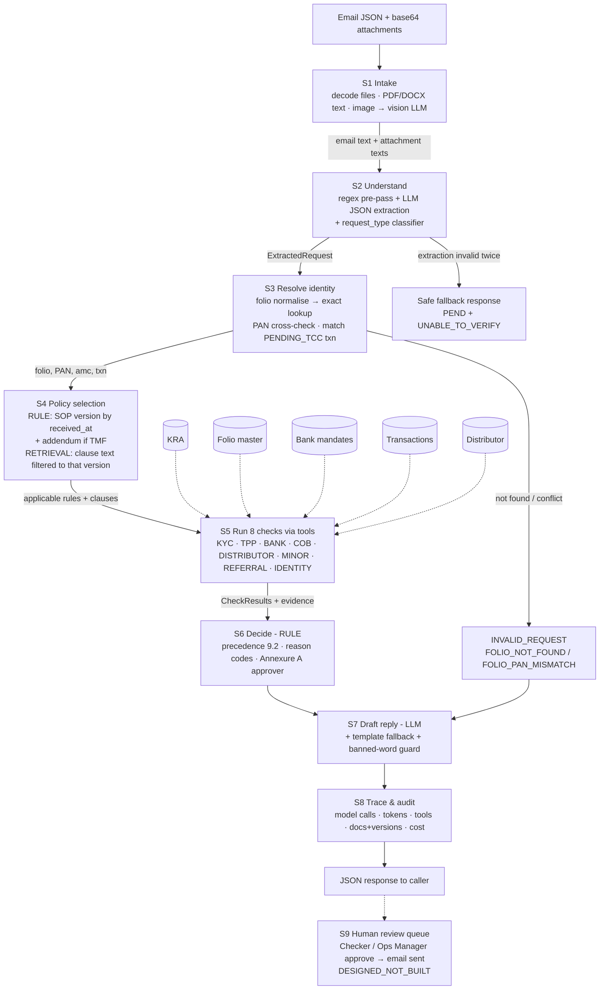

# Build prompt — Validus TCC Desk Compliance Agent

> Paste everything below into the agent. Put the unzipped data room at `./Data/` in the repo first (do not edit any file inside it).

---

## ROLE
You are a senior forward-deployed AI engineer. Build a production-quality, contract-exact HTTP service that automates the Transaction Compliance Check (TCC) desk of Validus, a mutual-fund RTA. Work in phases, show me the plan first as an implementation artifact, then build phase by phase, running tests after each phase. Commit after every phase with a clear message.

## WHAT TO BUILD — THE PRODUCT IN ONE PARAGRAPH
An **AI-powered TCC compliance agent** exposed as an HTTP API. Input: one email exactly as it reaches the desk (sender, subject, body, base64 attachments such as NEFT advices, scanned declarations, cancelled cheques, bank statements). Output: the desk's proposed decision — what kind of request it is, which folio/investor/transaction it is about, which compliance checks pass or fail with evidence from the five data systems and the exact SOP clause, the single outcome, whether a Checker or Ops Manager must approve, and a draft reply email — plus a full trace (LLM calls, tokens, tools, policy versions, cost). It replaces the maker's 12-minute manual routine (open 5 screens + rulebook, decide, write reply) with a ~seconds pipeline, and leaves humans only where the SOP reserves the decision.

## END-TO-END FLOW (build exactly this)



### What happens at each step (with a real example)
Example: **R02** — "Investment for my grandson Ishaan - folio 4017361278", from Vasant Kulkarni, with `NEFT_advice_Vasant_Kulkarni.pdf`.

| Step | What the code does | Who does it | Example output |
|---|---|---|---|
| **S1 Intake** | Decode each attachment. PDF → pdfplumber text; DOCX → python-docx; JPG/PNG → vision LLM transcription. Concatenate with subject + body, keeping file names for evidence. | Code + LLM (images only) | Email text + "NEFT advice: remitter VASANT G KULKARNI a/c XXXX…, ₹…, UTR …" |
| **S2 Understand** | Regex pulls folio/PAN/UTR/ARN/EUIN/amounts. LLM returns the ExtractedRequest JSON (intent, payer, relation, documents enclosed…). Classifier sets `request_type` (rules on keywords + txn_type of matched txn; LLM fallback). | Code + LLM | `ADDITIONAL_PURCHASE`, folio_raw `4017361278`, payer `Vasant Kulkarni`, relation `grandfather` |
| **S3 Resolve** | Normalise folio → `40173612/78`; exact lookup in folio_master; cross-check any PAN/name; find the `PENDING_TCC` txn by folio + amount/UTR. Mismatch → INVALID_REQUEST and skip to S7. | Code (tools) | NMF, minor folio, minor Ishaan, guardian Rohan (FATHER), txn T… |
| **S4 Policy** | received_at 2026-10-06 ≥ 2026-08-01 → SOP v4.1. AMC = NMF → no addendum. Retrieve clause texts 5.1, 5.4, 4.2… from v4.1 only. | Code + retrieval | documents_used: SOP v4.1 |
| **S5 Checks** | Each check calls its tools and returns PASS/FAIL/NOT_APPLICABLE/UNABLE_TO_VERIFY + evidence + clause + reason codes. | Code (tools) | THIRD_PARTY_PAYMENT = FAIL (remitter a/c not held by minor/parent/guardian; grandparent not allowed, v4.1 5.4) → TPP_NO_EXCEPTION. KYC (minor) = PASS. Others PASS / NOT_APPLICABLE |
| **S6 Decide** | Apply precedence INVALID > REJECT > HOLD > PEND > MODIFIED > PROCEED; collect all reason codes; approver from Annexure A. | Code | REJECT, [TPP_NO_EXCEPTION], approval true, CHECKER |
| **S7 Reply** | LLM writes a polite reply from outcome + reasons + clause text + required docs; to = sender. Guard: no "referral/suspicious/compliance/FIU/report" on held cases; never says "processed". Fallback to template on LLM failure. | LLM + code guard | "…we are unable to accept a payment from a grandparent's account into a minor's folio under our procedure; the amount will be refunded to the remitting account…" |
| **S8 Trace** | Collector records every LLM call (model, real tokens), every tool, every policy doc+version, cost = tokens × price table. | Code | trace object |
| **S9 Human** | Not in the API. Designed: queue shows the proposal + evidence to the Checker/Ops Manager, who approves/edits; only then is the email sent and the case logged. | Human (designed) | — |

### The tools the checks call (contracts)
| Tool | Input | Returns |
|---|---|---|
| `kra.lookup(pan)` | masked PAN | status (derived from code), kra, code, last_checked_at, row ref — or `None` |
| `folio.get(folio_no)` / `folio.by_pan(pan)` | canonical folio / PAN | folio row(s): holders, tax_status, guardian, minor_dob, flags, contact_last_changed_on |
| `bank.accounts(folio_no)` / `bank.find_by_account(last4, folio)` | folio, account | mandate rows: holders, status, default, registered_on, cob_request_received_on |
| `txn.pending(folio, amount, utr)` / `txn.history(folio, since)` / `txn.cash_total(pan, amc, fy)` | folio etc. | transaction rows |
| `distributor.validate(arn, euin, amc, on_date)` | codes + AMC + date | arn_status, validity, empanelled, euin match |
| `policy.select(received_at, amc)` / `policy.clause(doc, version, id)` / `policy.search(query, docs)` | — | chosen docs+versions / clause text |

### Where AI is used vs not
- **LLM:** reading scans/images, extracting fields from free-text emails in any wording, classification fallback, drafting replies. Optional (designed): an offline "policy update assistant" that reads a new SOP/addendum, diffs it against `rules.yaml`, and proposes changes for human approval + eval re-run.
- **Retrieval:** fetching exact clause text from the selected version for evidence and replies; finding the closest clauses for an unrecognised situation (→ route to human).
- **Code (never the LLM):** identity matching, version selection, every check, outcome, approver.

## NON-NEGOTIABLE PRINCIPLES
1. **The LLM never decides the outcome.** LLM is used only for: (a) extracting intent + fields from email text and attachments (incl. scanned images), (b) request-type classification fallback, (c) drafting the reply. Checks, outcome, reason codes and approver are deterministic Python.
2. **Never substitute a similar record.** Folio/investor not found or identifiers conflict → `INVALID_REQUEST` (FOLIO_NOT_FOUND / FOLIO_PAN_MISMATCH). No fuzzy matching on folio numbers.
3. **UNABLE_TO_VERIFY is never a pass.** Missing/contradictory/unreachable source → `UNABLE_TO_VERIFY`, and it blocks PROCEED.
4. **Every FAIL and every non-PROCEED outcome cites a clause + evidence** (`source` file, `ref` row key, `value`).
5. **The service proposes, never acts.** No sending emails, no processing, no refunds. Returns a draft reply + approval requirement.
6. **Raw files are never edited.** All cleaning happens in code, reproducible with ONE command.
7. **Policy is versioned data, not hardcoded logic.** Version selection is deterministic (by date + AMC); retrieval is filtered to the chosen version.
8. **Always return a contract-valid response**, even on internal error: fallback outcome PEND, every unrun check UNABLE_TO_VERIFY, `human_approval_required: true`, `approver_role: "CHECKER"`, plus an extra `error` field. Never 500 on `/requests`.
9. Generalise. The 10 inbox requests are samples of request TYPES; hidden test requests use other folios, rewording, and SOP situations none of the 10 show. Do not special-case R01–R10.

## TECH STACK
- Python 3.11, FastAPI, Uvicorn, Pydantic v2, SQLite (via sqlite3 or SQLAlchemy), PyYAML.
- Parsing: `pdfplumber` (PDF), `python-docx` (docx), images → vision LLM.
- LLM: provider-agnostic wrapper `app/llm.py` supporting Google Gemini (default, `gemini-2.0-flash` or current flash model) via env `LLM_PROVIDER`, `LLM_MODEL`, `LLM_API_KEY`. Must return real token counts from the API response usage metadata. JSON mode / response schema for extraction. Temperature 0.
- Retrieval: lightweight — BM25 (`rank_bm25`) or TF-IDF over parsed clauses, **filtered by document+version** before ranking. No vector DB needed.
- Deploy target: Render (or Railway). Port from `PORT` env var. Provide `Dockerfile` + `render.yaml`.
- Never commit keys. `.env.example` only.

## DATA ROOM (./Data) — facts you must respect
- `data/folio_master.csv` (83 rows), `bank_mandates.csv` (105), `kra_kyc_snapshot.csv` (95), `transactions.csv` (522), `distributor_master.csv` (32). Read `DATA_DICTIONARY.md` fully.
- Folio canonical form `XXXXXXXX/XX`. Emails write it as `4011882323`, `40118823/23`, `40115267 / 30`, `71167297 / 25` → normalise by stripping non-digits; must be exactly 10 digits; NMF starts 401, TMF starts 711.
- KRA status code: first digit = KRA, last two = status (07 Validated, 02 Registered, 03 On Hold, 04 Rejected, 01 Under Process, 05 Not Available, 99 service not reachable). Derive status from the code; if code and text disagree → UNABLE_TO_VERIFY and log a data issue.
- Remitter names in the bank feed are abbreviated ("R K BHAT"). Identify the payer by **remitter account number vs bank_mandates**, then holder lists; never by name alone.
- Known data quality traps (find all of them, log each in `data_issues.json`): e.g. transactions with negative units/NAV (T181000029), possible duplicates, masked PAN inconsistencies, code/text mismatch, dates in odd formats. Flag, don't delete.
- Policies: `Validus_TCC_SOP_v4.1.docx` (effective 2026-08-01, current), `Validus_TCC_SOP_v3.2.pdf` (effective 2025-01-01, SUPERSEDED — PDF may have watermark noise in text), `Tungabhadra_MF_Client_Addendum_TMF-ADD-02.pdf` (effective 2026-09-15, TMF folios only, prevails over SOP for TMF).
- `inbox/requests.json` = 10 API payloads (R01–R10) with base64 attachments (PDF, JPG scan, PNG cheque). `CURRENT_WORKFLOW.docx` contains a worked PROCEED example (Ravi Kumar Bhat, folio 40166450/93, T260900518) → use as eval case R00.

## RULES TO ENCODE (from SOP v4.1 + TMF-ADD-02) — put these in `app/policy/rules.yaml`, each with clause_id + version
Read the SOP yourself and verify every item; add anything missed.
- **KYC (4.1–4.6)** matrix by status × request type: Validated → accept all. Registered → PEND `KYC_REGISTERED_NEW_AMC` only for a new folio with an AMC the PAN holds no folio with; else accept. On Hold / Rejected → purchases/SIP "not accepted" (4.4, reason KYC_ON_HOLD / KYC_REJECTED) — decide REJECT vs PEND in Phase 1 from the SOP wording and record the reasoning; redemption → refer to Ops Manager (HOLD_AND_REFER). Under Process / Not Available / 99 / lookup older than 24h → UNABLE_TO_VERIFY, PEND `KYC_UNABLE_TO_VERIFY`. Minors: check the minor's KYC; joint new folios: all holders. Document your staleness reference time choice.
- **Third-party payment (5.1–5.7)**: TPP = paying account where the first holder is not an account holder (joint account OK if first holder is one of the holders). First holder's own unregistered account is not TPP but needs proof per 5.6 (else PEND `BANK_PROOF_REQUIRED`). Allowed exceptions 5.3 (employer payroll with ALL docs: TPP declaration, employer declaration on letterhead, employee list with code/PAN/KYC, KYC ack of investor and employer; custodian; AMC commission; corporate incentive). Docs missing → PEND `TPP_DOCS_MISSING` listing each missing doc (a ticked box ≠ enclosure). Outside exceptions → REJECT `TPP_NO_EXCEPTION` (refund). **Minor folios (5.4, v4.1): only minor / parent / legal guardian accounts allowed; grandparent or any other relative = TPP, not covered → REJECT.** (v3.2 allowed related persons — this is the key version difference.)
- **Minor attaining majority (5.5)**: from 18th birthday, all transactions/SIPs suspended → PEND `MINOR_ATTAINED_MAJORITY`.
- **Bank mandate / COB (6.1–6.5)**: payout only to VALIDATED registered account; unregistered account in a redemption request is disregarded → default account. Never pay to PENDING_VALIDATION. COB received within 10 calendar days before, or with, a redemption → payout held 10 days from COB receipt: PEND `COB_COOLING`. COB needs proof of new and existing account (TMF-ADD-02 A2: existing-account proof mandatory for TMF, in-person not accepted) else PEND `BANK_PROOF_REQUIRED`. Contact (email/mobile) changed within 30 days before COB + redemption during cooling → HOLD_AND_REFER `HIGH_RISK_CONTACT_COB`.
- **Distributor (7.1–7.4)**: Regular plan only. ARN invalid (expired/suspended/cancelled/not found/not empanelled with that AMC, validity checked at request date) → PROCEED_MODIFIED `ARN_INVALID_DIRECT` (process in Direct). EUIN blank → proceed Regular, `EUIN_MISSING` follow-up (unless execution-only declaration). Also validate EUIN belongs to the ARN and is in validity. Direct plan → NOT_APPLICABLE.
- **Referral (8.3–8.5)**: purchase(s) and redemption(s) each ≥ ₹25,00,000 within 14 days same folio → HOLD_AND_REFER `REFERRAL_TRIGGER`. STOP_LOCK folio → HOLD_AND_REFER `STOP_LOCK`. Cash > ₹50,000 per PAN per AMC per FY (Apr–Mar, aggregated across folios) → REJECT `CASH_LIMIT_BREACH`. **TMF-ADD-02 A1**: TMF redemption ≥ ₹5,00,000 within 30 days of a fresh/additional purchase in same folio (SIP instalments excluded) → HOLD_AND_REFER `REFERRAL_TRIGGER`.
- **Outcome precedence (9.2)**: INVALID_REQUEST > REJECT > HOLD_AND_REFER > PEND > PROCEED_MODIFIED > PROCEED. Record ALL applicable reason codes.
- **Approval (Annexure A)**: PROCEED/PEND/INVALID_REQUEST → `human_approval_required: false`, `approver_role: null`. PROCEED_MODIFIED/REJECT → true, `CHECKER`. HOLD_AND_REFER → true, `OPS_MANAGER`. (Document this mapping in README; the system role in SOP §3 "may not approve an outcome reserved to a role".)
- **Reply rules (8.6, Annex B)**: held/referred replies NEVER mention referral, suspicion, compliance or reporting — only "under processing" + next update date. Pend lists each document needed and where to send. Reject states reason in SOP terms + refund route. KYC on-hold reply gives no other reason (4.4). Reply goes to the sender (`from`); quote folio and request.

## API CONTRACT (exact — called automatically)
- `GET /health` → 200 `{"status":"ok"}`
- `POST /requests` body: `{request_id, received_at, channel, from, to, cc, subject, body, attachments:[{file_name, content_type, content_base64}]}`
- Response (Pydantic model with Literal enums, no extra nulls removed):
```json
{
  "request_id": "string",
  "request_type": "NEW_FOLIO_PURCHASE|ADDITIONAL_PURCHASE|SIP_REGISTRATION|SIP_INSTALMENT|REDEMPTION|CHANGE_OF_BANK|OTHER",
  "resolved": {"folio_no": "str|null", "amc_code": "NMF|TMF|null", "first_holder_pan_masked": "str|null", "txn_id": "str|null"},
  "outcome": "PROCEED|PROCEED_MODIFIED|PEND|REJECT|HOLD_AND_REFER|INVALID_REQUEST",
  "reason_codes": [],
  "checks": [{"check_id": "KYC_STATUS|THIRD_PARTY_PAYMENT|BANK_MANDATE|COB_COOLING|DISTRIBUTOR_CODE|MINOR_RULES|REFERRAL|FOLIO_IDENTITY",
              "result": "PASS|FAIL|NOT_APPLICABLE|UNABLE_TO_VERIFY",
              "evidence": [{"source": "file name", "ref": "row key/passage", "value": "what it showed"}],
              "sop_clause": "TCC-SOP v4.1 5.1 | TMF-ADD-02 A1"}],
  "human_approval_required": true,
  "approver_role": "CHECKER|OPS_MANAGER|null",
  "draft_reply": {"to": "", "subject": "", "body": ""},
  "trace": {"model_calls": [{"model": "", "input_tokens": 0, "output_tokens": 0}],
            "tools_called": [], "documents_used": [{"document": "", "version": ""}], "cost_usd": 0.0}
}
```
Always return all 8 check_ids (NOT_APPLICABLE where irrelevant). Extra fields allowed (e.g. `extracted`, `policy_selection`, `warnings`, `confidence`) — document in README.

## ARCHITECTURE — map to FUTURE_WORKFLOW stages S1–S9
```
app/
  main.py              # FastAPI routes; global try/except → safe contract response
  schemas.py           # request/response Pydantic models (Literal enums)
  pipeline.py          # orchestrator: run S1→S8, collect trace
  llm.py               # provider wrapper; records model, tokens, cost (price table in config)
  trace.py             # TraceCollector: model_calls, tools_called, documents_used, cost
  s1_intake.py         # decode base64; pdf/docx text; images → vision LLM transcription
  s2_extract.py        # LLM structured extraction (+ rule-based regex pre-pass for folio/PAN/UTR/ARN/EUIN/amount); request_type classifier (rules first, LLM fallback)
  s3_resolve.py        # folio normalise + exact lookup; PAN cross-check; txn match (PENDING_TCC by folio+amount/UTR/date); conflicts → INVALID_REQUEST
  s4_policy.py         # select SOP version by received_at vs effective dates; add addendum if amc=TMF and effective; BM25 retrieval filtered to selected docs
  tools/               # one module per system — pure functions returning records + evidence
    kra.py folio.py bank.py txn.py distributor.py
  checks/              # one function per check_id → CheckResult(result, evidence, sop_clause, reason_codes, proposed_outcome)
    kyc.py tpp.py bank_mandate.py cob.py distributor.py minor.py referral.py identity.py
  s6_decide.py         # precedence 9.2 + Annexure A approver
  s7_reply.py          # LLM drafts from {outcome, reason_codes, clause texts, missing docs}; template fallback if LLM fails; post-check banned words for held/referred (referral, suspicious, compliance, FIU, report)
  policy/rules.yaml    # all thresholds, reason→outcome, clause ids, versions, effective dates
scripts/prepare_data.py   # ONE command: raw → build/tcc.db + build/clauses.json + build/data_issues.json + record counts
eval/cases/*.json         # input payload ref + expected {request_type, outcome, reason_codes, check results, approver}
eval/run_eval.py          # calls a base URL; scores; writes eval/results/<UTC timestamp>.json + .md
tests/                    # pytest unit tests per check
```

## EXTRACTION SCHEMA (S2 LLM output, validated by Pydantic; retry once on invalid JSON)
`request_type_hint, folio_raw, pan, investor_name, minor_name, scheme_name, plan (REGULAR/DIRECT/null), option, amount_inr, payment_mode, remitter_name, remitter_account_last4, payer_relation_to_investor, utr, arn, euin, txn_date, new_bank_account_last4, new_bank_ifsc, documents_enclosed:[{type, present_as_attachment:bool, only_mentioned:bool}], is_cash, execution_only_declaration, sender_role (investor/distributor/employer/relative/other)`
Rules: never invent values; null if absent. Regex pass runs first; if regex and LLM disagree on folio/PAN → treat as conflict (INVALID_REQUEST unless one is clearly an email artefact; log warning).

## PHASED PLAN — execute in order, stop and show me after Phase 1
**Phase 1 — Understand (no code):** Read CURRENT_WORKFLOW.docx, all 3 policies, DATA_DICTIONARY, every inbox R01–R10 docx + attachments. Produce `docs/analysis.md`: per request R00–R10 the expected request_type, resolved folio/txn, each check result with clause, outcome, reasons, approver — reasoned from the data. Produce a v3.2 vs v4.1 diff table. List data issues found. **Wait for my review.**
**Phase 2 — Data prep:** `python scripts/prepare_data.py` → SQLite + clauses.json (doc, version, effective_from, clause_id, text) + data_issues.json + printed record counts. Idempotent.
**Phase 3 — Tools + checks + decide:** pure functions + pytest unit tests covering each rule branch (including UNABLE_TO_VERIFY paths). Synthetic fixture rows allowed in tests only.
**Phase 4 — LLM layers:** intake (pdf/docx/vision), extraction, classification fallback, reply drafting, trace + cost.
**Phase 5 — API:** FastAPI, contract model, never-500 guard. Run all 10 inbox payloads locally; diff against analysis.md.
**Phase 6 — Eval:** ≥30 cases: R00–R10 + ≥20 own cases covering every reason code in SOP 9.3 and: reworded emails, Hindi-English mix, folio typo (must be INVALID, not nearest match), PAN/folio conflict, KRA 99/01/05, KYC Registered new AMC, On Hold purchase vs On Hold redemption, grandparent → minor (REJECT), parent → minor (PROCEED), employer payroll with/without each doc, joint bank account, first-holder unregistered account w/ and w/o proof, minor turned 18, COB cooling, contact-change + COB + redemption, PENDING_VALIDATION payout account, expired/not-empanelled ARN, blank EUIN, STOP_LOCK, cash > 50k FY aggregate, ≥25L purchase+redemption in 14 days, TMF A1 5L redemption within 30 days (and same on NMF → no referral), TMF COB without existing-account proof, request dated before 2026-08-01 (v3.2 applies). Runner metrics: outcome accuracy, reason-code exact/partial match, check-level accuracy, approver accuracy, **unsafe errors** (expected ≠ PROCEED but got PROCEED/PROCEED_MODIFIED, or any FAIL/UTV reported as PASS) and **over-cautious errors** (expected PROCEED got anything stricter), median latency, median cost. Save timestamped JSON + markdown summary. Run → commit "before". Fix the top failure class → rerun → commit "after".
**Phase 7 — Deploy:** Dockerfile, render.yaml, env vars, smoke test public `/health` and one `/requests`. Run eval against the deployed URL too.
**Phase 8 — Docs (repo root):**
- `README.md`: setup, `prepare_data` command, run, env vars, where rules/policy config live, extra response fields.
- `FUTURE_WORKFLOW.md`: copy `Data/FUTURE_WORKFLOW_TEMPLATE.md` exactly; keep headings, stage IDs S1–S9, fixed values (RULE/RETRIEVAL/LLM/AGENT_TOOL/HUMAN; BUILT: <file:function> / DESIGNED_NOT_BUILT). Mermaid diagram with failure paths and human node. S9 human review queue + email sending = DESIGNED_NOT_BUILT. Impact % from the request mix (TPP 46%, KYC 18%, redemptions 17%, distributor 9%, COB 6%, other 4%; 1,800/day; maker 11 min, checker 3 min).
- `APPROACH.md` (1–2 pages, links to everything): A request types handled/not, B agent design (code vs model, version selection, failure path), C data & grounding, D evaluation design + bar before reducing human review, E risks & trade-offs. Every claim links to code.
- `ARTEFACT.md` + `ARTEFACT.html` (same content, styled): record counts per extract; one line per data issue + handling; policy docs + versions + selection logic; eval size & composition; first accuracy; unsafe vs over-cautious counts; the one change; after results; median cost/request; not built / fragile / next steps. Real numbers only, from eval/results.

## DONE CRITERIA
- `pytest` green; `python scripts/prepare_data.py` reproducible from raw files.
- All responses validate against the contract model; `/requests` never 500s.
- Zero unsafe errors on the eval set, or each remaining one explained in ARTEFACT.md.
- Deployed URL answers `/health` and `/requests` publicly without auth.
- No secrets in git history.
