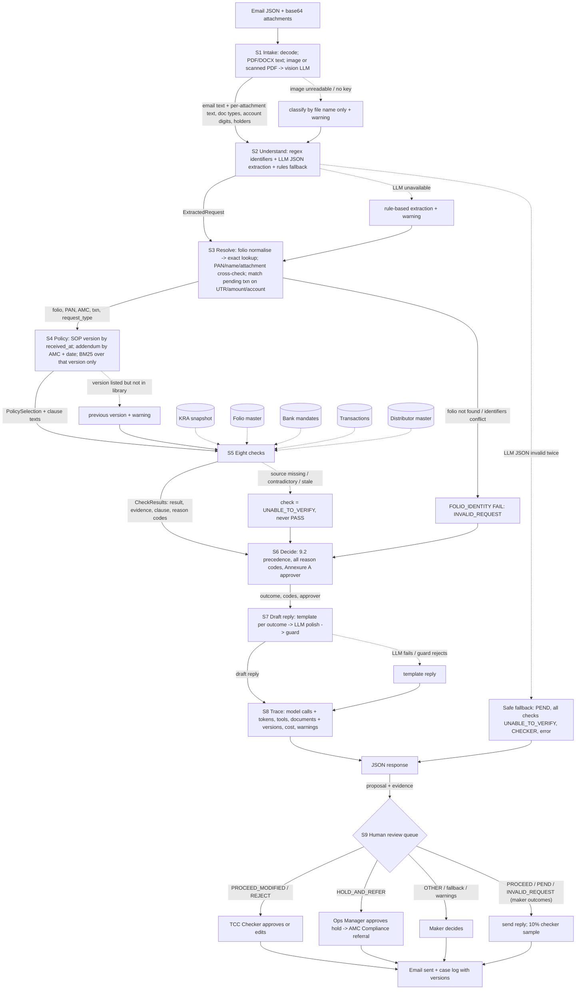

# Future workflow: from email request to response

*Copy this file to `FUTURE_WORKFLOW.md` at your repository root, link it from `APPROACH.md`, and fill in every section. Keep the section headings, the stage IDs and the fixed values exactly as given. Content outside this template is not read for the workflow.*

---

## 1. Diagram

One diagram of how a request travels through your system, from the email arriving to the response leaving, including where a person steps in. Write it as a **Mermaid flowchart** in the code block below.

- Use the stage IDs from section 2 (`S1`–`S9`) as node IDs for those stages. Add any other nodes you need: tools, stores, models, people.
- Label each edge with what passes along it where that isn't obvious.
- Show the failure paths, not just the happy path.

---

## 2. Stages

Every request passes through the nine stages below, in whatever order and combination your design uses. These are the jobs that have to be done, not a prescribed architecture. One component may do several stages: say so in the **component** column ("same agent as S3"). Add rows (`S10`, `S11`, …) for anything else your design does.

- **mechanism**: one or more of `RULE` (deterministic code), `RETRIEVAL`, `LLM`, `AGENT_TOOL` (a tool an agent decides to call), `HUMAN`. If you list more than one, say which does what.
- **on failure**: what happens when this stage's input or source is unavailable, sources conflict, or confidence is low, and where the request goes.
- **built?**: `BUILT: <file or function>` or `DESIGNED_NOT_BUILT`.

| stage | what has to happen | mechanism | component / tool | input → output | on failure | built? |
|---|---|---|---|---|---|---|
| S1 | Take in the request: email text and attachments, including scans | RULE (base64 decode, pdfplumber, python-docx, doc-type and field regexes) + LLM (vision transcription of images and text-less PDFs) | `app/s1_intake.py` `intake()` | request JSON → `AttachmentInfo` per file (text, doc types, account last 4, holders, IFSC, UTR, date, folio) | Corrupt or undecodable file → error recorded, file treated as not enclosed. No vision → type from file name only, plus a warning; a missing document is never assumed present | BUILT: app/s1_intake.py:intake |
| S2 | Work out what is being asked and pull out the facts the checks need | RULE (regex identifiers: folio, PAN, UTR, ARN, EUIN, amounts, account digits; keyword intent) + LLM (JSON-schema extraction of intent, relations, roles, documents; retry once) | `app/s2_extract.py` `regex_pass()`, `llm_extract()`, `heuristic_extract()`, `merge()` | text → `ExtractedRequest` | LLM identifiers not present in the text are discarded. Regex wins on identifiers. LLM invalid twice → safe fallback (PEND, CHECKER). LLM unavailable → rules only, plus a warning | BUILT: app/s2_extract.py:merge |
| S3 | Identify the folio, investor and transaction in the records | RULE + AGENT_TOOL (fixed tool calls: folio.get, folio.by_pan, kra.lookup, txn.pending, txn.by_utr) | `app/s3_resolve.py` `resolve()`; request type by `s2_extract.classify()` (matched txn type first) | extraction → folio row, PAN, AMC, pending txn, request type | Folio not in master (no fuzzy match) → INVALID_REQUEST FOLIO_NOT_FOUND. PAN, name, attachment folio or AMC conflict → FOLIO_PAN_MISMATCH. Ambiguous txn → none attached, warning. Duplicate pending rows → first id + warning | BUILT: app/s3_resolve.py:resolve |
| S4 | Find the rules that apply to this request (right document, version and client) | RULE (version by received_at vs effective dates; addendum by AMC + date) + RETRIEVAL (BM25 over clauses of the selected versions only) | `app/tools/policy.py` `select()`, `clause()`, `search()`; `app/policy/rules.yaml`; `build/clauses.json` | received_at, AMC → `PolicySelection` (SOP version, addenda, warnings) + clause texts | Version in force but not in the library (SOP v4.0, TMF-ADD-01) → previous version applied, warning in response. Before the earliest version → earliest, plus a warning | BUILT: app/tools/policy.py:select |
| S5 | Run the checks | RULE (each check is a pure function over tool results and rules.yaml) + AGENT_TOOL (kra/folio/bank/txn/distributor tools) | `app/checks/*.py` (8 checks) | Case → 8 × CheckResult (result, evidence: source file + row key + value, clause, reason codes, missing documents) | Source missing, stale (>24h), contradictory (KRA code vs text) or exception in a check → UNABLE_TO_VERIFY, which blocks PROCEED | BUILT: app/checks/__init__.py:REGISTRY |
| S6 | Decide the outcome, reason codes and approval | RULE | `app/s6_decide.py` `decide()` | CheckResults → outcome (9.2 precedence), all reason codes, approval (Annexure A) | UTV without a code → PEND. Request type OTHER → PEND for manual handling, never PROCEED | BUILT: app/s6_decide.py:decide |
| S7 | Draft the reply | RULE (template per outcome and reason: Annex B, 4.4, 8.6) + LLM (polish wording only) + RULE (guard: banned terms, facts preserved, folio quoted, no "processed") | `app/s7_reply.py` `draft()`, `template()`, `guard()` | outcome, codes, clause facts, missing documents → `{to, subject, body}` | LLM error or guard violation → template reply (always available) | BUILT: app/s7_reply.py:draft |
| S8 | Record what was used and decided (audit trail and `trace`) | RULE | `app/trace.py` `TraceCollector` (contextvar; tools self-record via `@tool`), `app/pipeline.py` | every LLM call (model, real token usage), tool, document + version, cost from the price table, latency, warnings, rationale | Collector is in-memory per request and returned even on the fallback path. Persistent case log is designed for S9 | BUILT: app/trace.py:TraceCollector |
| S9 | Human review and approval | HUMAN | Review queue UI: proposal, evidence, clause text, draft reply; Approve / Edit / Override with reason; email send + case log | response JSON → approved outcome + sent email + case-log row (request, records and versions relied on, checks, outcome, approver, time, reply: SOP 9.5) | Overrides recorded with reason and fed back as eval cases; queue SLA alerts to the Ops Manager | DESIGNED_NOT_BUILT |
| S10 | Policy update assistant: read a new SOP or addendum, diff it against rules.yaml, propose changes | LLM (diff and proposal) + HUMAN (approve) + RULE (re-run eval before release) | offline tool | new policy file → proposed rules.yaml patch + eval report | Never auto-applied; the eval must show zero unsafe errors before release | DESIGNED_NOT_BUILT |

---

## 3. Checks (detail of S5)

One row per check your system runs.

| check | data it reads | how it decides (mechanism and rule) | SOP clause | result when its source is unavailable |
|---|---|---|---|---|
| FOLIO_IDENTITY | folio_master.csv, kra_kyc_snapshot.csv, transactions.csv, email + attachment folios | RULE: canonical folio exact match; PAN position-wise match vs holder/guardian PANs; tolerant name match vs folio and KRA names; attachment folio must agree; AMC of the folio vs the requested scheme | TCC-SOP 9.4 | No folio/PAN/UTR identifies the investor → FAIL FOLIO_NOT_FOUND (INVALID_REQUEST) |
| KYC_STATUS | kra_kyc_snapshot.csv (status from the code, not the text), folio_master.csv (minor / joint new folio / AMC already held) | RULE: 4.2 matrix (status × new-AMC / AMC-held / additional / redemption). Registered + new AMC → PEND KYC_REGISTERED_NEW_AMC. On Hold/Rejected → REJECT (purchase) or HOLD_AND_REFER (redemption). Minor → minor's PAN; joint new folio → all holders | TCC-SOP 4.1–4.5 | Under Process / Not Available / 99 / >24h before received_at / code-text or agency conflict / no record → UNABLE_TO_VERIFY, KYC_UNABLE_TO_VERIFY (PEND) |
| THIRD_PARTY_PAYMENT | transactions.csv (remitter account, name, mode), bank_mandates.csv (this and the investor's other folios), attachments (statement, transfer advice, declarations), extraction (relation, category) | RULE: paying account → registered mandate holders must include the first holder (minor folio: minor/parent/guardian per version). Unregistered own account needs a 5.6 proof showing the account. Otherwise third party → 5.3 exception with every listed document enclosed; v3.2 related-person ≤ ₹50k for minors; else TPP_NO_EXCEPTION | TCC-SOP 5.1–5.7 | Paying account not identifiable → UNABLE_TO_VERIFY, BANK_PROOF_REQUIRED (PEND) |
| BANK_MANDATE | bank_mandates.csv, attachments (COB form, cheque, statement), extraction (requested payout account, in-person) | RULE: payout only to a VALIDATED registered account; a requested non-validated account is disregarded → default. Minor payout only to the minor's account. COB needs new-account proof + existing-account proof or in-person (TMF: existing proof mandatory) | TCC-SOP 6.1–6.3, 5.4; TMF-ADD-02 A2 | No VALIDATED default → UNABLE_TO_VERIFY (PEND) |
| COB_COOLING | bank_mandates.csv (cob_request_received_on), COB form date, folio_master.csv (contact_last_changed_on) | RULE: COB ≤10 days before or with a redemption → payout held 10 days (v4.1; v3.2 has no cooling). Contact changed ≤30 days before the COB + redemption in cooling → HIGH_RISK_CONTACT_COB | TCC-SOP 6.4, 6.5 | Folio not resolved → UNABLE_TO_VERIFY |
| DISTRIBUTOR_CODE | distributor_master.csv, txn/extraction (plan, ARN, EUIN) | RULE: Regular plan only. ARN status ACTIVE, validity on the request date, empanelled with the AMC. Invalid → v4.1 PROCEED_MODIFIED ARN_INVALID_DIRECT; v3.2 stays Regular with a 30-day follow-up. EUIN blank, not of this ARN or expired → EUIN_MISSING unless execution-only. SIP instalment under a registered ARN → 7.4 | TCC-SOP 7.1–7.4 | ARN not in master → treated as invalid (7.2 "not present in AMFI database") |
| MINOR_RULES | folio_master.csv (tax_status 02, minor_dob, guardian) | RULE: on or after the 18th birthday (instalment due date for SIPs) → PEND MINOR_ATTAINED_MAJORITY, change-of-status documents listed | TCC-SOP 5.5 | DOB or guardian missing on a minor folio → UNABLE_TO_VERIFY (PEND) |
| REFERRAL | folio_master.csv (folio_flag), transactions.csv (history de-duplicated; cash by first-holder PAN across the AMC's folios, processed only, FY Apr–Mar) | RULE: STOP_LOCK → HOLD_AND_REFER. Purchase and redemption each ≥ ₹25L within 14 days → REFERRAL_TRIGGER. Cash total > ₹50k → REJECT CASH_LIMIT_BREACH. Addendum A1 (TMF): redemption ≥ ₹5L within 30 days of NEW/ADD (SIP excluded) → REFERRAL_TRIGGER | TCC-SOP 8.3–8.5; TMF-ADD-02 A1 | History unavailable → check errors → UNABLE_TO_VERIFY (PEND) |

---

## 4. Where people stay in the loop

One row per decision or action a person must take or approve in your design.

| decision or action | who (role) | what they see when asked | why a person (SOP clause or risk) | could it be automated later? on what evidence? |
|---|---|---|---|---|
| Approve PROCEED_MODIFIED (e.g. switch to Direct) | TCC Checker | proposal, distributor-master evidence, clause 7.2 text, draft reply to distributor | Annexure A: checker approval required; SOP §3: automation may not approve | Partly: auto-approve ARN-expired cases once the checker override rate on them is <1% over 3 months and there are zero unsafe eval errors |
| Approve REJECT (TPP, KYC on hold, cash limit) and the refund route | TCC Checker | payer evidence (mandate rows, statement/advice), exception document list, refund account | Annexure A; money is refunded, so the error cost is high | No: refunds stay with a person; only the evidence gathering is automated |
| Approve payout hold and referral (HOLD_AND_REFER) | Operations Manager, then AMC Compliance | contact-change and COB dates, history window, STOP_LOCK flag, the trigger clause; the reply only says "under processing" | Annexure A; 8.1–8.2: the desk refers, AMC Compliance decides; FIU decisions rest with the AMC | No |
| Sample 10% of PROCEED | TCC Checker | random PROCEED proposals with full evidence | Annexure A (checker samples 10% daily) | Sampling rate could fall after 3 months of 0 sample findings |
| Requests with warnings: OTHER, unread scans, model/regex disagreement, fallback responses | TCC Maker | the proposal flagged "needs review" plus warnings | Low confidence; out of SOP scope (2.2) | Yes, case by case as extraction accuracy is proven on the eval set (≥99% on identifiers) |
| Approve rules.yaml changes from a new SOP or addendum | Head of Investor Services Ops + Compliance (RTA) | proposed diff, clause texts, eval results before and after | Policy ownership; SOP versioning (Annex D) | No |

---

## 5. Impact

| | % of daily requests | basis (use the volume and mix in CURRENT_WORKFLOW.docx) |
|---|---|---|
| Fully automatic (no person) | ~64% | Maker-only outcomes (PROCEED / PEND / INVALID_REQUEST, Annexure A) with no warnings. Assumed share per mix category: payment-source 46% × 0.6 = 27.6; KYC 18% × 0.7 (UTV / Registered pends) = 12.6; redemptions 17% × 0.85 = 14.5; distributor 9% × 0.5 (EUIN follow-ups, valid ARNs) = 4.5; COB 6% × 0.8 = 4.8. Sends with 10% checker sampling |
| Person confirms the system's proposal | ~28% | PROCEED_MODIFIED and REJECT need a checker (Annexure A): payment-source 46% × 0.4 = 18.4; KYC on hold/rejected 18% × 0.3 = 5.4; invalid ARN 9% × 0.5 = 4.5 |
| Person decides | ~8% | HOLD_AND_REFER (Ops Manager): redemptions 17% × 0.15 = 2.6; COB high risk 6% × 0.2 = 1.2; Other 4% (out of scope) = 4.0 |

Expected maker and checker minutes per request after the change, and why: about **0.6 maker minutes** (0.08 × 4 min on decide cases + 0.28 × 1 min spot-reading drafts on confirm cases; the lookups that took 9 of today's 12 minutes are automated) and about **1.0 checker minute** (0.28 × 3 min on approvals + 0.64 × 10% × 3 min sampling). Today it is 11 + 3 minutes. The per-category shares above are assumptions from the desk's mix, not measurements; they should be replaced with real proportions after a shadow-mode month.
